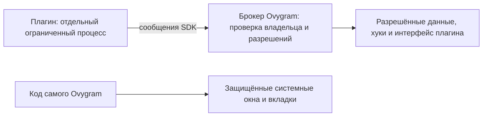

# Защищённые окна и вкладки Ovygram

Статус: **будущая работа, отложена владельцем 13 ноября 2026 года**.
В текущей итерации не выполнять переход на отдельные процессы и ограничения
ОС. Архитектура ниже — технический материал для будущей реализации.
Полная защита **ещё не реализована**; текущие проверки Plugin API её не заменяют.
Текущий объём — настройки, данные и обработчики по `installation_id`, без
отдельной пользовательской модели разрешений.

## Что требуется защитить

Сам Ovygram создаёт системные окна и вкладки внутри клиента: установку,
предупреждения, подтверждения и другие системные экраны. Плагин не должен
читать или менять их внутренние элементы, скрывать, перекрывать их своими
поверхностями, перехватывать их ввод или подтверждать действие за пользователя.
Требование распространяется на намеренный обход SDK произвольным кодом плагина.

Это защита границы приложения от кода плагина. Компрометация самой ОС,
действия другого привилегированного приложения и действия владельца компьютера
не входят в эту гарантию. Проверенный хеш не заменяет изоляцию.

## Почему текущая реализация недостаточна

Сейчас плагин исполняется через `exec` во встроенном Python процесса клиента.
Он может получить доступ к Python-объектам менеджера, вызвать системные функции
через ctypes или загрузить нативную библиотеку. Запрет конкретных SDK-команд,
флаг окна, название виджета или временная выгрузка обработчиков не образуют
границу безопасности при таком исполнении. Отдельного процесса без ограничений
ОС также недостаточно: он может обращаться к памяти процесса и оконной системе.

## Целевая граница

1. Каждый экземпляр плагина исполняется в отдельном ограниченном процессе.
   Там находятся его код, зависимости, asyncio и обработчики. Широкий доступ
   `desktop.native` реализуется запросами к брокеру и не даёт прямого доступа
   к памяти/Qt приложения.
2. Доверенный процесс хранит установки, настройки доступа, решения проверки,
   журнал обновлений и системный интерфейс. В нём не исполняется код пакетов
   или их зависимостей. Парсинг метаданных остаётся статическим.
3. Брокер определяет `installation_id` по установленному каналу процесса,
   а не доверяет присланному полю. Формат, размер, порядок, время выполнения
   и допустимость каждого запроса проверяются. Подмена чужого ID не передаёт
   владельцу другого процесса права.
4. Системные защищённые поверхности имеют владельца Application, отличный
   от Plugin. Их элементы и предки, способные скрыть или изменить поверхность,
   не становятся изменяемыми SDK-дескрипторами. Защита действует также для
   ранее полученных дескрипторов, подписок, селекторов и отложенных команд.
5. Поверхности плагинов ограничены своей областью. Они не могут создавать
   системные плашки доверия, глобальные перекрытия или захватывать ввод над
   защищённой поверхностью. Обработчики клавиатуры/мыши плагина не получают
   ввод из неё. Подтверждение принимается только контроллером системного UI.
6. Возможности, включая опасные низкоуровневые RPC и операции над предками
   окон, проверяются централизованно. Косвенное действие через SDK также не
   должно служить обходом защиты системного экрана.

## Ограничения ОС

- **Windows:** отдельный процесс с AppContainer/restricted token и низким
  уровнем целостности, без прав открытия процесса Ovygram для записи,
  инъекции, системных оконных перехватов и синтетического ввода в его окна.
  Пакет Python доступен только для чтения; рабочие файлы ограничены каталогом
  экземпляра. Требуется проверить фактические права, загрузку wheels и IPC.
- **Linux:** изолированные пространства процессов/монтирования, ограничения
  системных вызовов и файловой системы. В процессе плагина нет подключения
  к X11/Wayland, D-Bus сессии, устройствам ввода, `/proc` и памяти процесса
  Ovygram. Доступ к внешней сети предоставляется контролируемым способом,
  без пути к локальным отладочным и оконным службам приложения.
- Если требуемые ограничения ОС недоступны, запрещён незаметный запуск
  плагина в менее защищённом режиме. Пользователь получает причину отказа.

Конкретные платформенные механизмы и их достаточность подтверждаются кодом
и отрицательными тестами, а не только наличием флага запуска.

## Незакрытая реализация

- Протокол отдельного процесса и жизненный цикл на Windows/Linux.
- Перенос исполнения пакетов из доверенного Python-хоста.
- Привязка IPC-канала к UUID установки и ограничения ресурсов/тайм-аутов.
- Платформенные ограничения ОС и проверка их фактического применения.
- Общий контроллер защищённых системных окон/вкладок и фильтрация всей
  поверхности native/widgets/overlays/keyboard, включая старые регистрации.
- Техническая политика будущего брокера. Пользовательские разрешения и
  отдельные экраны их выдачи в текущий объём не входят.
- Совместимость всего SDK через брокер; регрессии аккаунтов, RPC, медиа,
  настроек, фоновых задач и выгрузки.

## Приёмка

Нужны тестовые враждебные плагины: подмена installation_id, изменение Python
менеджера, ctypes и нативный wheel, доступ к памяти/файлам хоста, оконные
сообщения и синтетический ввод, старый дескриптор/селектор, глобальный overlay,
запоздалый callback и попытка подтверждения. Проверяются также зависание и
аварийное завершение worker-процесса, сохранность клиента и данных.

Проверки обычного SDK должны продолжать проходить. Windows-сборки выполняются
через GitHub Actions только по отдельной команде владельца. Linux не собирается
через Actions; отдельный Linux workflow не требуется. Это уточнение не является
поручением запускать Linux-сборку. До завершения этих пунктов будущую полную
защиту нельзя считать реализованной. Отложенная задача не блокирует завершение
текущего согласованного объёма.
